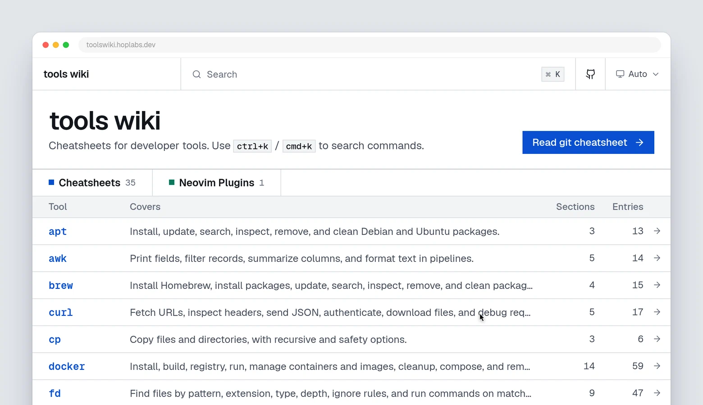

<a href="https://toolswiki.hoplabs.dev">
  
</a>

# tools wiki

Example-led cheatsheets for developer tools. Find the command, see what it prints, get back to work.

**[toolswiki.hoplabs.dev](https://toolswiki.hoplabs.dev)** · [Cheatsheets](https://toolswiki.hoplabs.dev/#cheatsheets) · [Neovim plugins](https://toolswiki.hoplabs.dev/#neovim-plugins)

Man pages list every flag. Blog posts bury the one command you need under a story. tools wiki sits in between: one page per tool, sections by subcommand or workflow, and every entry answers three questions. What does it do, what do I type, and what will I see.

```bash
$ git config --list --show-origin --show-scope
file:/home/user/.gitconfig  global  user.name=Alice Example
file:/home/user/.gitconfig  global  user.email=alice@example.com
file:.git/config            local   core.repositoryformatversion=0
```

## Features

- **Search everything.** Press `ctrl+k` or `cmd+k` and search every command, entry, and output line across the wiki.
- **Real output, not just syntax.** Command entries show representative terminal output, so you know what success looks like before you run it.
- **Markdown for agents.** Every page is also served as Markdown. Agents and CLI clients get it automatically; anyone can ask for it.
- **Shortcut tables.** Editor and multiplexer pages (neovim, vscode, tmux) use scannable `Key | Purpose | Result` tables.
- **Dense by design.** One ruled sheet with section and entry counts, so more fits on a screen. Light and dark themes.
- **Runs anywhere.** Deploys to Cloudflare Workers, or serves as static files from Docker and nginx.

## Markdown for agents

Point an agent or a script at any page and it gets clean Markdown instead of HTML:

```bash
# explicit .md endpoint
curl https://toolswiki.hoplabs.dev/cheatsheets/git.md

# content negotiation on the normal URL
curl -H 'Accept: text/markdown' https://toolswiki.hoplabs.dev/cheatsheets/git/
```

The Cloudflare Worker returns Markdown when the `Accept` header prefers it, or when the `User-Agent` matches a known agent or CLI client (Claude, ChatGPT, curl, wget, and others). Browsers keep getting HTML.

## What's inside

| Collection | Pages | Includes |
| --- | --- | --- |
| [Cheatsheets](https://toolswiki.hoplabs.dev/#cheatsheets) | 35 | git, docker, kubectl, tmux, ssh, rsync, curl, jq, ripgrep, fd, sed, awk, xargs, neovim, vscode, and more |
| [Neovim plugins](https://toolswiki.hoplabs.dev/#neovim-plugins) | 1 | grug-far |

## Adding a tool

1. Follow [AGENTS.md](AGENTS.md) for content approval and structure.
2. Create `src/content/docs/cheatsheets/{tool}.md`, or `src/content/docs/neovim/{plugin}.md` for a Neovim plugin. Subdirectories map to URLs: `cheatsheets/git.md` serves `/cheatsheets/git/`.
3. Add frontmatter:

   ```yaml
   ---
   title: tool-name
   description: Concise summary of the tool's workflows.
   ---
   ```

4. Organize commands under `##` sections; use tables for simple shortcuts.
5. Add an approved home page ToolIndex entry in `src/content/docs/index.mdx`.

## Development

Built with [Astro Starlight](https://starlight.astro.build). Use Node.js 26 and pnpm 11.5.0, from the repository root.

```bash
pnpm install
pnpm run dev        # starts at http://localhost:4321
pnpm run build      # outputs to dist/
pnpm run check      # build, typecheck, worker tests, directory validation
```

`check` builds first to generate the worker's Markdown path manifest. After a build, `pnpm run typecheck` and `pnpm run test` can run independently. Typechecking covers the site, worker, and tests.

Astro dev and preview serve static pages; Markdown negotiation runs in the Cloudflare Worker. See [deployment](docs/deploy.md) for Cloudflare prerequisites and commands.

## Docker

```bash
docker build -t tools-wiki .
docker run -p 8080:80 tools-wiki
```

Docker serves static HTML and `.md` files with nginx. Automatic Markdown negotiation is available on the Cloudflare deployment.

## License

[MIT](LICENSE)
